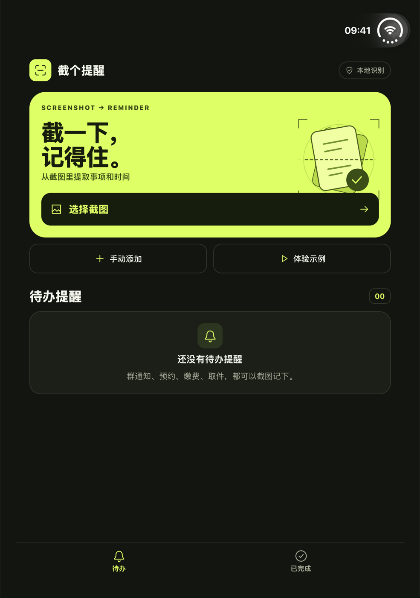
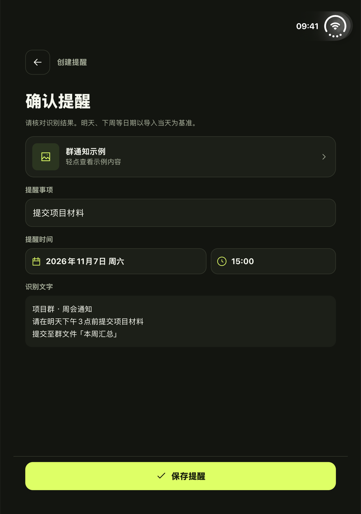

# 截个提醒 · ShotRemind

用一张截图创建提醒。适合记下群通知里的材料截止时间、预约短信里的复诊时间，以及缴费、取件等日常待办。支持 iOS 和 Android，使用 React Native、Expo 和 TypeScript 开发。

## 界面预览

| 首页 | 确认提醒 |
| :---: | :---: |
|  |  |

截图来自 iOS 27.1 模拟器。确认页使用 App 内置的群通知示例。

## 使用流程

1. 点「选择截图」，从相册导入一张含事项和时间的图片。也可以点「体验示例」走一遍流程。
2. 检查识别出的事项和时间，可切换候选或手动编辑。只有日期时预填 09:00；「明天」「下周二」等相对日期以导入当天为准。
3. 保存并允许系统通知。Android 12 及以上如果提示缺少「闹钟和提醒」权限，请在系统设置中开启后返回保存。
4. 点按通知或提醒列表中的事项，再点「原始截图」回看来源。处理完可标为完成，也可以删除提醒和应用内的截图副本。

「手动添加」可以创建一条没有截图的提醒。截图识别在设备上完成，提醒和原图副本保存在应用本地。

在相册或其他 App 里选中一张图片，从系统分享菜单点「截个提醒」，也可直接进入确认页。已有草稿会保留，新的截图会在当前编辑结束后打开。

系统分享入口需要重新生成并构建原生应用。iOS 真机签名需要给主应用及分享扩展配置同一个 App Group（`group.app.shotremind.mobile`）。Expo 的 iOS 分享跳转仍属实验功能，建议在目标设备上验证。

## 发图前遮隐私

在首页点「发图前遮隐私」，从相册选一张快递单、订单截图或聊天记录。应用在设备上标出疑似手机号、地址和姓名。点按标框应用或取消遮挡。漏识别的区域可以点「手动框选」，再点图片上矩形的两个对角。检查整张图后，点「分享遮挡后的图片」，通过系统分享一张写入实色遮挡的 PNG 副本。

## 家里东西放哪了

从首页打开「家里东西放哪了」，点「拍照记位置」，填上物品名和一句位置，例如「护照」放在「书房柜子第二层」。以后输入完整或部分物品名，就能看到照片和位置。点进记录可以更改位置、重拍照片或删除记录。照片和记录保存在当前设备。

## 家庭采购清单

创建清单后，点「邀请家人」发送邀请码。另一台设备输入邀请码即可加入同一份清单。每次打开默认显示「未买」，点商品即可勾选。勾错可以在「已买」中恢复。两台设备联网时约每 4 秒同步，离线时显示上次同步结果。

共享清单需要一台两部手机都能访问的服务。用 `npm run shopping:server` 启动服务，默认端口为 8787。用 HTTPS 反向代理提供访问地址，并在 App 的 `.env` 中设置 `EXPO_PUBLIC_SHOPPING_API_URL=https://你的服务域名`。两台设备使用同一个地址，修改后重启 Metro 或重新打包。上线时将 `SHOPPING_DB` 指向持久磁盘，并在代理层对公开的创建接口 `POST /lists` 限流。持有邀请码的人可以查看和编辑清单。

## 出门办事资料包

新建一张资料包卡片，填写办事名称、地址和材料，并可导入一张预约截图。出门前逐项勾选，到现场点卡片即可查看地址、材料状态和预约截图。点击截图可全屏查看。资料包和截图保存在设备上，离线也能打开。

## 纪念日

在首页打开「纪念日」，填写事件名称并选择日期。过去的日子显示「已过去 X 天」，未来的日子显示「还有 X 天」，当天显示「就是今天」。记录按设备的本地日历计算，点进条目可以编辑或删除，离线也能使用。

## 本地运行

- **通用** · Node.js 22.13+ 或 24.3+、npm。
- **iOS** · macOS、Xcode、CocoaPods，以及 iOS 模拟器或设备。
- **Android** · JDK 17、Android SDK 36、NDK `27.1.12297006`，以及 Android 模拟器或设备。

```sh
git clone https://github.com/misanyrock/shotRemind.git
cd shotRemind
npm ci
npm run prebuild

# 选择一个平台
npm run ios
npm run android
```

原生 OCR 模块需要 Expo 开发构建。完成首次安装后，可用 `npm start` 启动 Metro。根目录的 `ios/` 和 `android/` 由 Expo Prebuild 生成，自定义原生 OCR 源码保存在 `modules/shot-ocr/`。

```sh
npm run typecheck
```

## 项目结构

| 路径 | 用途 |
| --- | --- |
| `App.tsx` | 导入截图、确认提醒、待办列表和详情界面 |
| `src/recognize.ts` | 从 OCR 文字中提取事项和中文日期时间 |
| `src/reminders.ts` | 本地存储、截图副本管理和系统通知 |
| `modules/shot-ocr/` | iOS Vision 和 Android ML Kit OCR 桥接 |
| `plugins/` | Expo 原生工程生成配置 |

## 许可证

本项目采用 MIT 许可证，见 [LICENSE](LICENSE)。第三方依赖适用各自的许可证。
